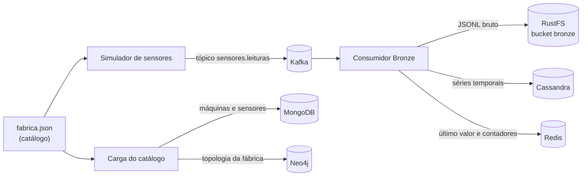

# Plataforma IoT — Integração de Dados II

Projeto integrador da disciplina Integração de Dados II (PUC Minas, Prof. Ricardo Carlini Sperandio).

Uma fábrica simulada com 2 linhas de produção, 10 máquinas e 50 sensores envia leituras
(temperatura, vibração, pressão, umidade e corrente) a cada segundo. A plataforma recebe essas
leituras, guarda o dado bruto na camada **Bronze** e distribui cada tipo de informação para o banco
NoSQL mais adequado.

**Entrega 1 — Fundação** (este estado do repositório): infraestrutura Docker, simulador de sensores,
modelagem NoSQL e ingestão para a camada Bronze.



Detalhes em [docs/arquitetura.md](docs/arquitetura.md), modelagem em
[docs/modelagem-nosql.md](docs/modelagem-nosql.md) e decisões em [docs/adr/](docs/adr/).

## O que é preciso ter instalado

- **Docker Desktop** (com WSL 2) aberto e rodando
- **Git**

Todo o resto (Python, bancos, Kafka) roda dentro do Docker.

## Por que o projeto sobe em dois grupos

O ambiente completo não cabe em 8 GB de RAM. Por isso os serviços estão em dois **perfis**:

| Perfil | Serviços | Memória aproximada |
|---|---|---|
| `ingestao` | RustFS, Kafka, Cassandra, Redis, console do Kafka, simulador, consumidor | ~2,5 a 3 GB |
| `catalogo` | MongoDB, Neo4j, Mongo Express, carga do catálogo | ~1,5 GB |

**Suba um perfil de cada vez.** Feche navegadores com muitas abas enquanto o ambiente roda.

## Passo a passo

Todos os comandos são no **PowerShell**, dentro da pasta do projeto:

```powershell
cd "C:\Users\annal\Integração de dados\plataforma-iot"
```

### 1. Construir a imagem Python (só na primeira vez, ou quando o código mudar)

```powershell
docker compose build
```

### 2. Subir a ingestão

```powershell
docker compose --profile ingestao up -d
```

O Cassandra demora de 1 a 3 minutos para ficar pronto. Acompanhe com:

```powershell
docker compose --profile ingestao ps
```

Quando o serviço `init` aparecer como **Exited (0)** e `simulador` e `consumidor` como **Up**, está tudo funcionando.

### 3. Ver os dados chegando

```powershell
docker compose logs -f consumidor        # Ctrl+C para sair (o serviço continua rodando)
```

A cada 60 segundos aparece uma linha `"msg": "lote gravado"`. Depois de 1 ou 2 lotes:

```powershell
docker compose run --rm ferramentas python -m consultas.verificar_bronze
docker compose run --rm ferramentas python -m consultas.consultas_exemplo --banco cassandra
docker compose run --rm ferramentas python -m consultas.consultas_exemplo --banco redis
```

Telas no navegador:

| Endereço | O que é | Login |
|---|---|---|
| http://localhost:9001 | Console do RustFS (arquivos da Bronze) | `rustfsadmin` / `rustfsadmin123` |
| http://localhost:8080 | Console do Kafka (tópico e mensagens) | — |

### 4. Trocar para o catálogo

```powershell
docker compose --profile ingestao stop
docker compose --profile catalogo up -d
```

O serviço `carga-catalogo` carrega o MongoDB e o Neo4j e termina sozinho (cerca de 1 minuto). Depois:

```powershell
docker compose run --rm ferramentas python -m consultas.consultas_exemplo --banco mongo
docker compose run --rm ferramentas python -m consultas.consultas_exemplo --banco neo4j
```

| Endereço | O que é | Login |
|---|---|---|
| http://localhost:7474 | Neo4j Browser (grafo da fábrica) | `neo4j` / `senha12345` |
| http://localhost:8081 | Mongo Express (coleções do MongoDB) | — |

No Neo4j Browser, rode `MATCH (n) RETURN n` para ver o grafo inteiro.

### 5. Parar tudo

```powershell
docker compose --profile ingestao --profile catalogo stop     # para, mantendo os dados
docker compose --profile ingestao --profile catalogo down     # remove os containers, mantém os dados
docker compose --profile ingestao --profile catalogo down -v  # apaga TUDO, inclusive os dados
```

### 6. Rodar os testes

```powershell
docker compose run --rm --no-deps ferramentas pytest -q
```

## Como mandar um erro para análise

Salve a saída do comando num arquivo da pasta `logs`:

```powershell
docker compose --profile ingestao ps 2>&1 | Out-File -Encoding utf8 logs\status.txt
docker compose logs --tail 200 init consumidor simulador 2>&1 | Out-File -Encoding utf8 logs\saida.txt
```

## Configurações que dá para mudar

Copie `.env.example` para `.env` e ajuste. O padrão funciona sem `.env`.

| Variável | Padrão | Efeito |
|---|---|---|
| `SIM_INTERVALO` | `1.0` | segundos entre leituras de cada sensor |
| `SIM_PROB_ANOMALIA` | `0.01` | chance de começar uma anomalia, por leitura |
| `SIM_SEED` | `42` | semente do simulador (mesma semente = mesmos dados) |
| `LOTE_MAX_MENSAGENS` | `2000` | tamanho máximo do lote gravado na Bronze |
| `LOTE_MAX_SEGUNDOS` | `60` | tempo máximo de espera para gravar um lote |

## Estrutura

```
plataforma-iot/
├── docker-compose.yml          serviços, perfis e limites de memória
├── app/                        código Python (vira a imagem plataforma-iot-app)
│   ├── catalogo/               fabrica.json e o script que o gera
│   ├── simulador/              gerador de leituras e envio ao Kafka
│   ├── ingestao/               consumidor e regras da camada Bronze
│   ├── infra/                  criação de buckets, tópico, schema do Cassandra e cargas
│   ├── consultas/              consultas de exemplo e verificação da Bronze
│   ├── comum/                  configuração, logs em JSON, schema das mensagens
│   └── tests/                  testes automatizados (pytest)
├── docs/
│   ├── arquitetura.md
│   ├── modelagem-nosql.md
│   ├── runbook.md              operação e solução de problemas
│   └── adr/                    registros de decisão de arquitetura
└── logs/                       saídas de comandos para análise (fora do Git)
```

## Próximas entregas

- **Entrega 2 — Pipeline:** jobs Spark Bronze → Silver → Gold, DAGs no Airflow e dashboard básico.
- **Entrega 3 — Integração final:** pipeline de streaming, alertas de anomalias, testes de qualidade e demonstração.
