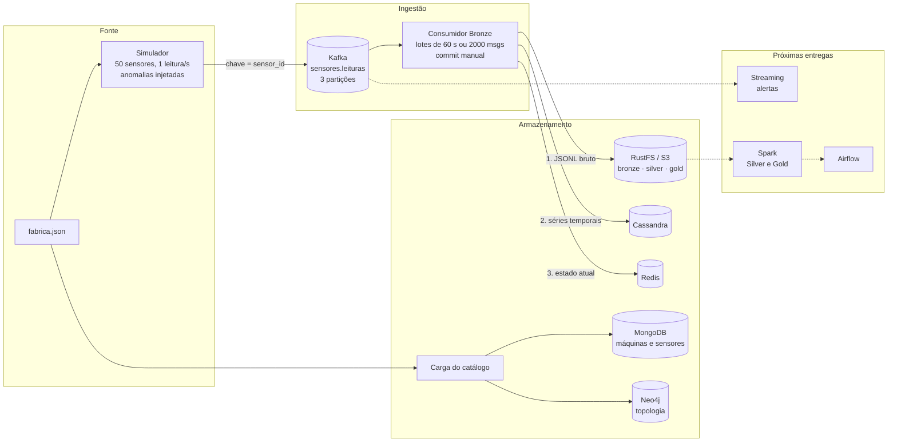

# Arquitetura — Entrega 1 (Fundação)

## Cenário

Uma fábrica com duas linhas de produção (L1 Usinagem, L2 Montagem), cinco máquinas por linha e
cinco sensores por máquina, total de 50 sensores. Cada sensor envia uma leitura por segundo:
cerca de 4,3 milhões de leituras por dia.

A fábrica está descrita em `app/catalogo/fabrica.json`, gerado com semente fixa por
`app/catalogo/gerar_catalogo.py`. O fim da linha L1 (L1-M05) alimenta o início da linha L2 (L2-M01).

## Visão geral



## Fluxo de uma leitura

1. O **simulador** gera a leitura e publica no Kafka com chave `sensor_id`. Com a mesma chave,
   todas as leituras de um sensor vão para a mesma partição e mantêm a ordem.
2. O **consumidor** acumula mensagens até 2000 ou 60 segundos e então:
   1. grava o lote **bruto** na Bronze, em JSONL, particionado por dia e hora da leitura;
   2. grava as leituras válidas em três tabelas do Cassandra;
   3. atualiza no Redis o último valor de cada sensor e os contadores por minuto;
   4. confirma os offsets no Kafka.
3. Se o consumidor falhar antes do passo 4, o lote é lido de novo. Isso não gera duplicatas na
   Bronze (o nome do arquivo depende só da partição e dos offsets) nem no Cassandra (upsert
   pela chave primária). Ver [ADR 0004](adr/0004-kafka-como-barramento-de-ingestao.md).

## Mensagem no Kafka (contrato)

```json
{
  "versao_schema": 1,
  "evento_id": "S-L1-M02-TEMP:1532",
  "sensor_id": "S-L1-M02-TEMP",
  "maquina_id": "L1-M02",
  "linha_id": "L1",
  "setor": "A",
  "tipo": "temperatura",
  "valor": 57.214,
  "unidade": "C",
  "status": "ok",
  "ts": "2026-11-24T13:15:02.123Z",
  "anomalia_injetada": null
}
```

- `status`: `ok`, `warning` ou `error`, calculado a partir dos limites de cada tipo de sensor.
- `anomalia_injetada`: `pico`, `travado`, `deriva` ou `null`. É o gabarito para avaliar a detecção de
  anomalias na Entrega 3. A anomalia `ausente` não gera mensagem: aparece como leituras faltando.
- O contrato está validado em `app/comum/esquema.py`.

## Registro na Bronze

Caminho: `bronze/sensores/leituras/dt=2026-11-24/hora=13/p1-000000004000-000000005999.jsonl`

```json
{
  "dado": { "...mensagem original..." },
  "_kafka": {"topico": "sensores.leituras", "particao": 1, "offset": 4000, "chave": "S-L1-M02-TEMP", "ts_ms": 1795…},
  "_ingestao_ts": "2026-11-24T13:16:00.004+00:00",
  "_particionado_por": "evento"
}
```

Uma mensagem que não é JSON válido também é guardada, em `bruto`, com o motivo em `_erro_parse`.
A Bronze nunca descarta dados. Ver [ADR 0003](adr/0003-formato-e-particionamento-da-bronze.md).

## Serviços e portas

| Serviço | Perfil | Porta(s) | Limite de memória |
|---|---|---|---|
| rustfs | ingestao | 9000 (S3), 9001 (console) | 384 MB |
| kafka | ingestao | 29092 (acesso externo) | 900 MB |
| cassandra | ingestao | 9042 | 1,2 GB |
| redis | ingestao | 6379 | 128 MB |
| kafka-console | ingestao | 8080 | 192 MB |
| init, simulador, consumidor | ingestao | — | 192 a 256 MB |
| mongo | catalogo | 27017 | 512 MB |
| neo4j | catalogo | 7474, 7687 | 900 MB |
| mongo-express | catalogo | 8081 | 128 MB |
| carga-catalogo | catalogo | — | 192 MB |

Ver [ADR 0005](adr/0005-perfis-e-limites-de-memoria.md).

## Observabilidade nesta entrega

- Todos os serviços Python escrevem **logs estruturados em JSON** (`app/comum/log.py`), com campos
  como `mensagens`, `validas`, `invalidas`, `duracao_ms` e offsets por partição.
- O consumidor mantém **métricas** no Redis (`metricas:consumidor_bronze`): mensagens, inválidas e lotes.
- O Redis registra quando cada sensor foi visto pela última vez (`sensores:ultimo_visto`), base
  para o alerta de sensor parado na Entrega 3.
